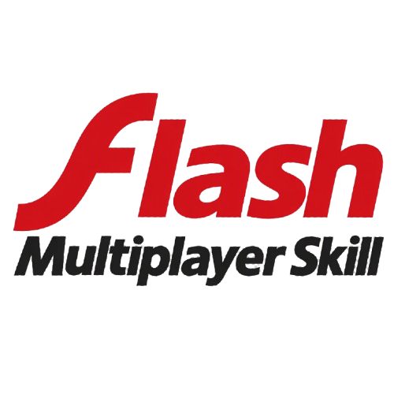

<p align="center">
  
</p>

<p align="center"><b>Old Flash games. Your friends, online. Your agent does the work.</b></p>

<p align="center">
<a href="https://discord.gg/2SJggtHqPR"></a>
<a href="https://github.com/multiplayereverything/ruffle-together"></a>
<a href="https://gitgem.org/github/multiplayereverything/flash-multiplayer-skill"></a>
</p>

<p align="center">
<a href="#quick-start">Quick start</a> ·
<a href="#how-it-works">How it works</a> ·
<a href="#what-you-can-make-online">What you can make online</a> ·
<a href="#games-so-far">Games so far</a> ·
<a href="#everyone-is-a-contributor">Contribute</a> ·
<a href="#faq">FAQ</a> ·
<a href="#documentation">Docs</a>
</p>

Want to play an old Flash game with your friends over the internet? Point your AI coding agent at this repo and name
the game. It reads the SWF, works out how to give it more players, **tests it with scripted players and real
windows**, and ships it, all without touching the original file.

Every game here plays in **[Ruffle Together](https://github.com/multiplayereverything/ruffle-together)**, a fork of the
Ruffle Flash emulator: every PC runs the same game in lockstep and only the key presses travel. The host gets a
5-letter room code, friends type it, and nobody forwards a port. A game that already has two players on one keyboard
usually needs nothing but a key map. A single-player game gets local co-op added to the SWF, still with no network
code.

Games online so far: **Bad Ice-Cream** · **Gun Mayhem 2** · **Territory War** · **Fireboy & Watergirl** ·
**Stealth Hunter 2** · **Raft Wars** · **Intrusion** · **Stealth Assassin** · **Smileys War** · **Dad 'n Me** ·
**Bow Man** · **Air Battle** · **Ultimate Crab Battle** · yours next?

## Quick start

Tell your agent (Claude Code, Codex, Gemini CLI, Cursor, ...), in the folder with the game's `.swf`:

```
Read https://github.com/multiplayereverything/flash-multiplayer-skill and follow AGENTS.md.
I want to play <game>.swf online with my friends.
```

The agent follows [AGENTS.md](AGENTS.md) and the skills in [`.claude/skills/`](.claude/skills).

### Install it as a skill

```bash
npx skills add multiplayereverything/flash-multiplayer-skill
```

Add `-g` to install it for every project. That installs one skill, `flash-multiplayer`, with the whole hub inside it:
the seven phase skills, playbook, tools and templates. You need
[Ruffle Together](https://github.com/multiplayereverything/ruffle-together/releases/latest), and for games that need
changes, Java 21, [FFDec](https://github.com/jindrapetrik/jpexs-decompiler) 26.x and Python 3.10+. The agent asks
before installing anything.

## How it works

Your agent takes one of two paths.

| | Path A: local multiplayer to online | Path B: single player to multiplayer |
|---|---|---|
| When | The game already has 2+ players on one keyboard | One player only |
| How | Write a key map: which game keys each player's buttons press. Test it with scripted players, ship it | Map the game's code, add more heroes that each read their own player's input, keep everyone on screen, test, ship |
| Skills | `flash-start`, `flash-lab`, `flash-ship` | `flash-start`, `flash-map`, `flash-inject`, `flash-coop`, `flash-lab`, `flash-ship` |
| Guide | [Ruffle Together](playbook/ruffle-together.md) | [Ruffle Together](playbook/ruffle-together.md), [build](playbook/build.md) |

Both end the same way: replays that match twice with screenshots looked at, 2-4 players in the co-op lab, two real
windows, a release, and what was learned sent back here (`flash-share`).

Why no netcode: Ruffle Together makes the clock, randomness, timers and sound endings the same on every PC, so the
whole game stays identical when every PC gets the same key presses. Every 25 frames the PCs compare a fingerprint of
the whole stage and say so if they ever differ.

### Tools

Game-agnostic, in [`tools/`](tools). `python -I tools/test_all.py` checks them all (each check has a twin that must
fail) and prints `ALL OK`.

| Tool | What it does |
|---|---|
| `keys_check.py` | checks a Ruffle Together key map the way Ruffle Together reads it |
| `swfheader.py`, `swfinfo.py`, `swfmap.py` | SWF version, AS2 or AS3, fps, frames; frame labels; the display tree of obfuscated AS2 games |
| `ffdec/AddClasses.java`, `CheckNamespaces.java`, `ListClasses.java` | AS3: stub classes for `importScript`, the protected-namespace guard, class listing |
| `ffdec/InsertAction.java` | AS2: compile files into new DoAction tags on a frame |
| `case_scan.py`, `swfsym.py`, `unmochi.py` | SWF 6 name collisions; link a sprite to a new class; unwrap MochiCrypt |
| `wincap.py` | screenshot a test window by process id, never focusing it |
| `check_public.py` | refuses tokens, keys, passwords, personal paths, emails, home and VPN IPs, game files |
| `directory.py` | validates the directory and renders `DIRECTORY.md` |

[`templates/`](templates) has an example key map, an input script, a replay check, and the build scripts that put
co-op code into a SWF.

## What you can make online

| Your game is... | Typical approach | Example |
|---|---|---|
| Local multiplayer, each player on their own keys | A key map, nothing in the SWF | Bad Ice-Cream, Gun Mayhem 2, Fireboy & Watergirl |
| Hot-seat (players take turns on the same keys) | A `shared` key map: a key is down while anyone holds it | Territory War |
| Turn-based, single player | Read each player's keys; act only on the turn owner's | Raft Wars |
| Single-player action or stealth | Extra heroes on the same screen, each on their own keys; enemies see the nearest one | Stealth Hunter 2, Intrusion, Stealth Assassin, Dad 'n Me |
| Single player against bots | Humans take the bots' places, with their own keys and mouse | Smileys War |
| A new SWF made for Ruffle Together | The co-op API: each player's buttons and mouse, a camera per player, HUD, name tags, events | ruffle-coop's API demo |

## Games so far

| Game | What was done | Players | Write-up |
|---|---|---|---|
| Bad Ice-Cream (2010) | Built-in key map, the untouched game | 2 | [bad-ice-cream](games/bad-ice-cream.md) |
| Gun Mayhem 2 | Built-in key map | 2-4 | [gun-mayhem-2](games/gun-mayhem-2.md) |
| Territory War (2007) | Shared hot-seat key map, the untouched game | 2-4 | [territory-war](games/territory-war.md) |
| Stealth Hunter 2 | Local co-op added: P2-P4 as extra heroes, one camera on everyone | 2-4 | [stealth-hunter-2](games/stealth-hunter-2.md) |
| Raft Wars (2007) | Local turn co-op added, each player on their own keys | 1-4 | [raft-wars](games/raft-wars.md) |
| Intrusion (2008) | Local co-op added; the game's one player swapped to the nearest one per enemy | 2-4 | [intrusion](games/intrusion.md) |
| Stealth Assassin (2014) | Local co-op added: 2-4 assassins on their own keys | 2-4 | [stealth-assassin](games/stealth-assassin.md) |
| Smileys War (2007) | Humans in place of bots, with their own keys and mouse | 1-4 | [smileys-war](games/smileys-war.md) |

The [directory](DIRECTORY.md) has the details and how each one was proven (QA level). The finished builds are in
[flash-games](https://github.com/Multiplayer-Everything-Team/flash-games), which the Multiplayer Mods Launcher
downloads from.

## Everyone is a contributor

Every agent that works on a game sends what it learned back here: a directory entry with an honest QA level, a
write-up, new traps, a better tool. One person's agent gets a game halfway; the next one starts from there.

- The `flash-share` skill walks through it; your agent opens the commit or pull request after you've reviewed it.
- Contributors: read [CONTRIBUTING.md](CONTRIBUTING.md). Open a draft PR, one game per PR, and the pull request template
  does the rest. Fork only if you can't push to the repo.
- The **QA level** on every entry says how it was proven: not tested, tested with 2 players, with 3+ players, or
  played online by real people on two networks.
- A new key map goes to [Ruffle Together](https://github.com/multiplayereverything/ruffle-together) too, so it's built in.

Chat with other players and modders on [Discord](https://discord.gg/2SJggtHqPR).

## FAQ

<details><summary>Do I need to know how to code?</summary>
No. You need the game's SWF, a coding agent and some patience. The agent asks before installing anything or using
your accounts.
</details>

<details><summary>Do my friends need anything?</summary>
Ruffle Together (the Multiplayer Mods Launcher installs and updates it) and the same SWF as the host. No accounts and
no port forwarding.
</details>

<details><summary>Do I need a server?</summary>
No. Ruffle Together's public relay gives out the room codes. You can run your own relay from <a href="relay/README.md">relay/</a>
if you want to.
</details>

<details><summary>Will it work for my game?</summary>
If it runs in Ruffle, very likely. Games that already have local multiplayer are often done in an afternoon; a
single-player game takes longer, depending on how its code finds "the player". Check the
<a href="DIRECTORY.md">directory</a> first.
</details>

<details><summary>Does this hub contain the games?</summary>
No. No game files and no decompiled game code are here. The release builds live in the flash-games repo, where rights
holders can ask for removal.
</details>

## Documentation

- [AGENTS.md](AGENTS.md): rules and phase map for agents · [SKILL.md](.claude/skills/flash-multiplayer/SKILL.md): the route on one page ·
  [skills](.claude/skills)
- References: [Ruffle Together](playbook/ruffle-together.md) · [recon](playbook/recon.md) ·
  [build](playbook/build.md) · [traps](playbook/traps.md) · [release](playbook/release.md) ·
  [relay protocol](playbook/relay-protocol.md)
- [DIRECTORY.md](DIRECTORY.md) and the [game write-ups](games) · [templates](templates/README.md) ·
  [relay](relay/README.md) · [mods-info kit](modsinfo/README.md)

## Rules

Don't commit game files or decompiled code here. No personal info. Credit the games and mods you build on. Co-op
with friends only: nothing that cheats in other people's games.
